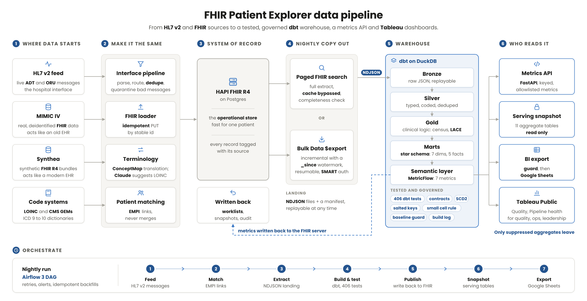
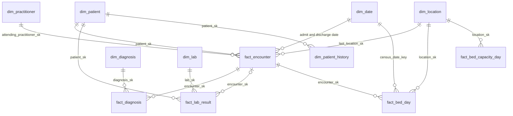

# FHIR Patient Explorer: data pipeline

An end to end healthcare data pipeline. It takes **HL7 v2** messages and **FHIR R4** data from three sources, makes
them consistent (codes, patients, formats), keeps them in a FHIR server as the system of record, copies them out every
night into a tested **dbt** warehouse on **DuckDB**, and serves suppressed aggregates through a **semantic layer**, a
**metrics API** and **Tableau Public** dashboards. **Airflow 3** runs it every night.



## Highlights

| Area | What it shows | Result |
|---|---|---|
| Integration | HL7 v2 ADT and ORU feed: parse, route, dedupe by MSH 10, quarantine, map to US Core FHIR | 3,978 messages over 56 nightly runs, 0 load failures |
| Terminology | Local labs to LOINC, ICD 9 to ICD 10 (CMS GEMs), published as FHIR ConceptMaps | LLM ranker on a 316 item holdout: 66% top 1 against a 53% lexical baseline |
| Patient matching | EMPI with blocking, Jaro Winkler, nicknames; links, never merges | precision 1.0, recall 0.95, 0 of 10 hard negatives linked, same on a held out set |
| Extract | Paged FHIR search or Bulk Data `$export` (incremental, resumable, SMART Backend Services) | NDJSON landing files with a manifest and a completeness check |
| Warehouse | dbt: Bronze, Silver, Gold, a star schema (7 dims, 5 facts), SCD2, contracts | 406 data tests, source freshness, a baseline guard; [dbt docs and lineage](https://nischaldinesh.github.io/fhir-patient-explorer/) |
| Semantic layer | dbt MetricFlow, 7 metrics, 2 saved queries | parity checked against hand written SQL |
| Governance | Salted pseudonyms, CMS small cell rule (1 to 10) with complementary suppression | a guard refuses any export with an id or a small count |
| Serving | FastAPI metrics API, serving snapshot (11 tables), Google Sheets export, Tableau Public | [Pipeline health dashboard](https://public.tableau.com/views/FHIRExplorerPipelineHealth/Pipelinehealth) |
| Orchestration | Airflow 3 DAG `fhir_nightly`: retries, timeouts, failure and deadline alerts, backfills | one CLI command per task |

## How it works

The diagram reads left to right. Each step has its own folder and README.

### 1. Where data starts

| Source | What it is | Acts like |
|---|---|---|
| HL7 v2 feed | A generated, deliberately messy feed for an invented hospital (Riverside General): ADT A01, A02, A03, A04, A08 and ORU R01 | the live hospital interface |
| MIMIC IV demo on FHIR | 100 real, deidentified ICU patients (PhysioNet) with local lab codes and ICD 9 | an older EHR |
| Synthea | 100 synthetic patients in FHIR R4, already coded in LOINC and SNOMED | a modern EHR |
| Code systems | LOINC and the CMS General Equivalence Mappings | the translation dictionaries |

### 2. Make it the same

* **Interface pipeline** (`hl7v2/`): parses each message, routes it (process, skip, deduplicate, quarantine), maps it to
  US Core FHIR and loads it idempotently. A nightly run generates and loads one more day. See `hl7v2/README.md`.
* **FHIR loader** (`tools.py`): loads MIMIC and Synthea with PUT by stable id, so a rerun changes nothing.
* **Terminology** (`terminology/`): maps MIMIC labs to LOINC and ICD 9 to ICD 10 and publishes FHIR ConceptMaps
  (`$translate`). For the 441 labs nobody mapped yet, `terminology/llm_loinc/` retrieves 20 LOINC candidates (BM25, no
  LLM), Claude picks one or answers NONE, and a validator drops any code that was not a candidate. Every suggestion goes
  to a review queue; only a person's accept adds it to the map. Evaluation: `docs/LLM_LOINC_EVAL.md`.
* **Patient matching** (`empi/`): finds the same person across systems and links the records with `Patient.link`.
  Records are never merged or deleted. See the results below.

### 3. System of record

**HAPI FHIR R4 on PostgreSQL** holds every source as FHIR, each record tagged with its source. It is fast for one
patient and is what clinical apps read. The warehouse writes its results back here as FHIR Binaries: the bed board and
the readmission follow up worklist (reverse ETL), an aggregate snapshot and the pipeline history.

### 4. Nightly copy out

`analytics/build.py extract` copies everything out as NDJSON landing files plus a manifest, in one of two modes:

* **Paged FHIR search** (default): a full extract that bypasses HAPI's search cache and checks completeness.
* **Bulk Data `$export`** (`--mode bulk`, `analytics/bulk.py`): incremental with a `_since` watermark, resumable after a
  crash, and able to sign in with SMART Backend Services (RS384 client assertion).

### 5. Warehouse

`analytics/dbt/` is a dbt project on DuckDB:

* **Bronze**: the raw JSON exactly as landed, so any build can be replayed.
* **Silver**: typed, coded and deduplicated, one row per thing.
* **Gold**: clinical logic: daily census, bed board, weekly metrics, LACE readmission risk, a patient crosswalk.
* **Marts**: a Kimball star schema (`dim_patient`, `dim_date`, `dim_location`, `dim_practitioner`, `dim_diagnosis`,
  `dim_lab`; `fact_encounter`, `fact_diagnosis`, `fact_lab_result`, `fact_bed_day`, `fact_bed_capacity_day`) and
  monthly and period quality measures.
* **Semantic layer**: MetricFlow defines 7 metrics once (admissions, emergency visits, average length of stay, 30 day
  readmission rate, bed days, bed occupancy rate, admissions over 28 days). See `analytics/SEMANTIC_LAYER.md`.

Every build runs 406 data tests, enforced model contracts, source freshness and SCD2 history for patient demographics.
A baseline guard (`analytics/baseline.py`) fingerprints the warehouse to prove a refactor changes no result. Each build appends a record to a build log.
The same models are also rendered as Snowflake SQL (`analytics/sql/snowflake/`), with masking policies and secure views.



Browse every model, column, test and the lineage graph in the
**[dbt docs](https://nischaldinesh.github.io/fhir-patient-explorer/)** (rebuilt by GitHub Actions on every push).

Quality measures (`mart_quality_monthly`, `mart_quality_period`): 30 day all cause readmission rate, average and median
length of stay, emergency department median length of stay, diabetes HbA1c under 8 percent (HEDIS style, not
certified) and abnormal potassium on admission. Details and limits: `analytics/README.md`.

### 6. Who reads it

Only suppressed aggregates leave the warehouse. Counts from 1 to 10 are hidden (the CMS cell size rule), plus
complementary suppression so a hidden cell cannot be worked out by subtraction.

* **Metrics API** (`api/`): FastAPI over the semantic layer, keyed with `X-API-Key`, allowlisted dimensions (at most two).
* **Serving snapshot**: a slim, read only copy of 11 aggregate tables, so readers never block the nightly build.
* **BI export** (`analytics/export_bi.py`): eleven tabs to Google Sheets through a service account. A guard refuses the
  whole export if any tab has an id column, an identifier or a count from 1 to 10.
* **Tableau Public**: a Quality dashboard and a
  [Pipeline health dashboard](https://public.tableau.com/views/FHIRExplorerPipelineHealth/Pipelinehealth), built from
  the sheet. Specification: `docs/tableau/DASHBOARD_SPEC.md`.

### Orchestrate

`orchestration/airflow/` runs the whole pipeline as the Airflow 3 DAG `fhir_nightly` in Docker: feed, prune reports,
match patients, extract, dbt build and test, semantic layer validation, source freshness, publish, serving snapshot and
BI export. Every task has retries with backoff and a timeout; a failed task and a missed 45 minute deadline post to a
Slack or Discord webhook. See `orchestration/airflow/README.md`.

## Results

**Patient matching** (448 patients plus a seeded test set of 20 true matches and 10 hard negatives):

| Set | Precision | Recall | Hard negatives auto linked | In review |
|---|---|---|---|---|
| Tuning set, seed 42 | 1.0 (19 of 19) | 0.95 (19 of 20) | 0 of 10 | 3 |
| Held out set, seed 7 | 1.0 (19 of 19) | 0.95 (19 of 20) | 0 of 10 | 3 |

**LLM assisted LOINC mapping** on a holdout of 316 MIMIC III coded lab items that no prompt or retrieval choice saw:
Claude Sonnet 5.5 reaches 66% top 1 against 53% for a lexical baseline; every suggestion still goes to review. Full
evaluation with intervals, calibration, cost and latency: `docs/LLM_LOINC_EVAL.md`.

**Coding coverage** (`gold_terminology_quality`): MIMIC labs 85.2% LOINC and diagnoses 88.0% ICD 10 after mapping; the
HL7 v2 feed 100% LOINC.

**Feed**: 3,978 messages over 56 nightly runs: 65.9% processed, 31.7% skipped by routing, 2.0% duplicates, 0.4%
quarantined; every run succeeded with 0 load failures.

## Quick start

Requirements: Docker Desktop (4 GB RAM), Python 3.10+.

```bash
# 1. FHIR server
docker compose up -d && python3 tools.py wait

# 2. Sources
python3 tools.py download && python3 tools.py mimic          # MIMIC IV demo
mkdir -p data/synthea && curl -L -o data/synthea/synthea.jar \
  https://github.com/synthetichealth/synthea/releases/download/master-branch-latest/synthea-with-dependencies.jar
docker run --rm -v "$PWD/data/synthea:/work" -w /work eclipse-temurin:17-jre \
  java -jar synthea.jar -s 42 -cs 42 -r 20260101 -p 100 Massachusetts
python3 tools.py synthea
python3 hl7v2/pipeline.py reference && python3 hl7v2/pipeline.py daily   # hospital master data, one feed day
python3 tools.py verify

# 3. Terminology and matching
python3 terminology/build_maps.py && python3 terminology/conceptmaps.py load
python3 hl7v2/pipeline.py empi-seed && python3 empi/match.py run

# 4. Warehouse
python3 -m pip install -r analytics/requirements.txt
python3 analytics/build.py extract && python3 analytics/build.py build && python3 analytics/build.py publish

# 5. Serve
python3 analytics/build.py snapshot
api/run.sh                                                  # metrics API on http://127.0.0.1:8000/docs
python3 analytics/export_bi.py export --target csv          # or --target sheets
```

To run it every night instead, start Airflow: `orchestration/airflow/README.md`.

## Tests

```bash
python3 -m pip install pytest -r analytics/requirements.txt -r api/requirements.txt \
  -r analytics/requirements-bulk-auth.txt -r terminology/llm_loinc/requirements.txt
python3 -m pytest -q tests     # no network, no API key
docker compose -f orchestration/airflow/compose.yaml exec airflow-scheduler \
  python -m pytest -q -p no:cacheprovider /opt/project/orchestration/airflow/tests
```

## Repository layout

| Folder | Step |
|---|---|
| `hl7v2/` | HL7 v2 feed generator, parser, router, FHIR mapping, hospital master data |
| `tools.py`, `docker-compose.yml`, `hapi.application.yaml` | HAPI FHIR on Postgres, MIMIC and Synthea loading |
| `terminology/` | LOINC and ICD 10 maps, ConceptMaps, LLM assisted LOINC mapper |
| `empi/` | Patient matching |
| `analytics/` | Extract, dbt warehouse, semantic layer, serving snapshot, BI export, Snowflake SQL |
| `api/` | Metrics API |
| `orchestration/airflow/` | Nightly Airflow DAG |
| `docs/` | Diagram, LLM evaluation, Tableau dashboard spec |
| `tests/` | Test suite |

## Data and privacy

MIMIC IV Clinical Database Demo on FHIR (v2.1.0), PhysioNet, Open Data Commons Open Database License v1.0. MIMIC
shifts dates into the future (years like 2150) to protect privacy. Synthea data is fully synthetic (Apache 2.0). The
HL7 v2 hospital, its staff and its patients are invented. LOINC is used under the LOINC license and is not included in
this repository. No data, keys or credentials are committed.
