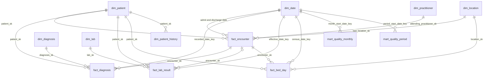

# Analytics warehouse

The FHIR server answers questions about one patient at a time. Analytics asks questions about everyone
at once, so the data is copied into a warehouse built for that, in layers:

| Layer | Table(s) | What it holds |
|---|---|---|
| Landing | `data/analytics/landing/*.ndjson` | FHIR resources extracted from the server, one file per type, plus `feed_runs.json` (the live feed's run history) and `Binary.ndjson` (only `Binary/empi-review` and `Binary/empi-truth`, the EMPI's JSON documents) |
| Bronze | `bronze_resources` | Every resource exactly as extracted (JSON / VARIANT) with lineage: source file, load time, row id |
| Seeds | `seed_lab_loinc`, `seed_icd9_icd10`, `seed_key_labs`, `seed_cohort_codes`, `seed_charlson_codes`, `seed_unmapped_labs` | The curated mapping tables from `terminology/` and the analytics definitions |
| Silver | `silver_patient`, `silver_encounter`, `silver_encounter_location`, `silver_condition`, `silver_observation`, `silver_location`, `silver_practitioner`, `silver_care_team_member`, `silver_patient_link`, `silver_empi_pair`, `silver_empi_truth` | Typed, deduplicated on resource id, with LOINC and ICD 10 standardized where known; the attending, priority and the last bed per visit; who is on each care team; the EMPI's links, review queue and test set truth |
| Tests | `dq_checks`, `dq_test_results` | dbt data tests: unique ids, no orphan references, no visit ending before it starts, allowed values |
| Gold | `gold_*` | Business answers, see below: the archive, and the operational tables of the live feed |
| Marts | `dim_*`, `fact_*`, `mart_quality_monthly`, `snap_patient_demographics` | A star schema (Kimball) for BI tools and monthly hospital quality measures, built on Gold, see below |
| Governed | `analyst_*` views, `governance_roles` | What an analyst may see: pseudonyms, no identifiers, see below |
| Semantic | `models/semantic/*.yml`, `fact_bed_capacity_day` | dbt MetricFlow: 7 business metrics defined once, queried with suppression through `metrics.py`, see `SEMANTIC_LAYER.md` |

It is a **dbt** project (dbt Core with the dbt-duckdb adapter) in `analytics/dbt/`. It runs locally in **DuckDB**
(free, one file, no account). The same Silver and Gold SQL is rendered for **Snowflake**.

## Gold: the business answers

| Table | Answers |
|---|---|
| `gold_encounter_summary` | Length of stay per visit and 30 day readmissions. MIMIC ICU stays sit inside a hospital stay (FHIR `partOf`) and are not counted as new admissions. Also the attending's name, the last unit and bed, and the number of bed moves (the Riverside General feed) |
| `gold_lab_latest` | Latest value, range flag and history of key labs per patient, matched by LOINC across all sources (`dbt/seeds/key_labs.csv`) |
| `gold_bmi` | BMI from the latest weight and the height measured closest to it, next to the BMI the source reported as a cross check. Under 20s are labelled instead of given an adult category |
| `gold_aki_signal` | Kidney injury screening signal: creatinine up 0.3 mg/dL or more within 48 hours (one KDIGO criterion, simplified) |
| `gold_patient_summary` | One row per patient: age (at death, hidden for shifted MIMIC dates, or as of the extract), admissions, inpatient days, readmissions, diagnoses, review backlog, labs out of range, BMI, kidney signal |
| `gold_cohort_members`, `gold_cohorts` | Cohorts defined once in `dbt/seeds/cohort_codes.csv` across ICD 10, ICD 9 and SNOMED CT, so each finds patients whatever code system they arrived in; plus low sodium, kidney signal and readmission cohorts. `people` counts one person per master id of `gold_patient_crosswalk`, `records` (and the older `patients`) every record; a test checks people never exceed records |
| `gold_terminology_quality` | Per source: share of lab results with LOINC, diagnoses arriving as ICD 9 or SNOMED, share with ICD 10, review backlog |
| `gold_patient_crosswalk` | One row per patient record with one master id per person across sources: records joined by `Patient.link` (the EMPI, `empi/match.py`) share the master id, following links up to 10 steps |
| `gold_empi_quality` | One row: precision and recall of the EMPI's automatic links against the seeded test set (`silver_empi_truth`), hard negatives linked automatically, pairs in review. The same numbers `empi/match.py` prints; a test checks they agree |

Gold is plain SQL with no JSON access, so it runs unchanged in DuckDB and Snowflake.

## Operational tables: the live feed, every day and every month

MIMIC and Synthea are the archive: their dates are shifted or historical, so they answer population questions, not
"who is in bed 214 tonight". The operational tables use only the live Riverside General feed (`hl7v2/`, invented
patients on real dates, visit numbers `V<yyyymmdd><nn>`); the original 25 patient feed is archive too. Built on
`gold_live_encounter` and `gold_feed_freshness`. The nightly job loads yesterday, so "today" is the **data date**, the
day of the last feed event, and every published document carries it.

| Table | What it holds | How a real hospital uses it |
|---|---|---|
| `gold_daily_census` | Per day: patients in house at midnight, admissions, discharges, ED visits, transfers, average stay of the day's discharges | **Bed management and the daily safety huddle.** Every morning the house supervisor, unit charge nurses and bed managers go over yesterday's midnight census, who came and went, and the transfers, to plan staffing and today's discharges |
| `gold_bed_board`, `gold_unit_occupancy` | Per unit, beds occupied out of capacity (bed status from the Location); per bed the patient, admit time, day of stay, attending, and flags from the latest labs of the stay (kidney signal, low sodium, abnormal potassium) | **The bed board**, on a screen at the nursing station and in the huddle: where there is room for the next admission, who has stayed long, which results need a look. A hospitalist filters it to their own patients (the attending is `attending_practitioner_id`) |
| `gold_readmission_risk` | LACE index for every live feed discharge in the last 30 days: L, A, C (Charlson from seed `charlson_codes`, Quan 2005 ICD 10 coding), E, the band, whether a readmission already happened, the care manager from the CareTeam, Transitional Care Management due dates (contact within 2 business days, visit within 7 days for high risk or 14 otherwise, with overdue flags) and a suggested service (Cardiology Clinic for heart failure, else Discharge Follow Up Clinic) | **Care management calls and Transitional Care Management.** A care manager works the list top down every morning: calls high risk patients first, reconciles medications, books the follow up visit. Medicare pays for this work (CPT 99495 and 99496) only when the contact and the visit happen in time |
| `gold_weekly_metrics` | Per ISO week: admissions, discharges, ED visits, 30 day readmissions of the week's discharges and their rate, median and 90th percentile stay, abnormal lab rate, LOINC and ICD 10 coverage, diagnoses waiting for a coder, kidney signals | **The monthly quality committee** reviews these trends, and readmissions in particular: under the **CMS Hospital Readmissions Reduction Program** Medicare cuts payments to hospitals with more readmissions than expected. `readmission_window_complete` says when a week's rate can no longer rise |
| `gold_terminology_quality` and the coding columns of `gold_weekly_metrics` | Share of results with LOINC, diagnoses with ICD 10, the review backlog | **Clinical documentation integrity (CDI).** CDI specialists and coders work the backlog of diagnoses that cannot be coded without a human (an ICD 9 code with several ICD 10 options), because coding drives both quality measures and payment |

Notes on the rules:

* LACE (van Walraven et al., CMAJ 2010). L: under 1 day 0, 1 day 1, 2 days 2, 3 days 3, 4 to 6 days 4, 7 to 13 days 5,
  14 or more 7 (whole 24 hour days). A: emergency admission (Encounter.priority EM, from HL7 v2 PV1-4) 3. C: Charlson
  score from every diagnosis recorded up to the discharge, 0 to 3 as is, 4 or more 5; when a condition and its more
  severe form are both present only the severe one counts (`superseded_by`). E: ED visits in the 182 days before the
  admission, up to 4. Band: 10 or more high, 5 to 9 moderate, under 5 low.
* The Charlson seed lists the Quan 2005 ICD 10 prefixes with the original Charlson weights, plus the ICD 9 codes the
  generator sends that are Charlson conditions (heart failure 428, diabetes 250.0x), so a diagnosis still counts while
  its ICD 10 upgrade waits for a coder. Acute kidney failure (584.9) is not a Charlson condition: renal disease means
  chronic kidney disease.
* Business days skip weekends only (public holidays are not known): a Friday discharge has its contact due on Tuesday.
  The date math is the macro `add_business_days` (`dbt/macros/dates.sql`), written in SQL both engines run unchanged.
  The demo has no record of calls or visits, so "overdue" only means the due date has passed on the data date.
* Live feed data quality tests (`dbt/tests/live_*.sql`): no discharge before admission, no admission open more than 30
  days (a lost discharge message), no bed with two current patients, every lab result has a LOINC code or is on the
  reviewed list `seeds/unmapped_labs.csv`. Integrity tests: the midnight census carries over day to day, weekly counts
  equal the sum of their days, every LACE score adds up and its band follows it.
* The run history (`Binary/pipeline-run-history`, saved by `extract` as `landing/feed_runs.json`) can hold several runs
  of one day (a retry or a rerun); publish keeps the newest run of each day (`publish.latest_runs_by_day`).

## Marts: a star schema for BI tools

Gold answers fixed questions. A BI tool (Tableau, Power BI) wants a dimensional model it can slice any way: facts at a
stated grain, joined to dimensions by surrogate keys. `analytics/dbt/models/marts/` builds one on top of Gold (nothing
upstream changes), plus a dbt snapshot in `analytics/dbt/snapshots/`.



| Model | Grain (one row per) | Notes |
|---|---|---|
| `dim_patient` | person (`gold_patient_crosswalk.master_id`) | Records the EMPI linked are one member. Source list, sex, birth year, age band, deceased flag, state. No name, MRN, address below the state, exact birth date or FHIR id. Age band and birth year follow the analyst views (ages 90 and over grouped, no birth year) |
| `dim_patient_history` | patient record and version | SCD type 2 view on the snapshot: `valid_from`, `valid_to`, `is_current`, sex, deceased flag, state, address version and whether it changed (not the address itself) |
| `dim_date` | calendar day | From 1 January of the year of the earliest date in the data to 31 December of the year of the latest (MIMIC's shifted dates take it to 2202). ISO year and week, month, quarter and their first days, weekday, `is_weekend` |
| `dim_location` | place | Site, unit, room, bed, clinic; unit, room and bed names, bed capacity of the unit and room, bed status now |
| `dim_practitioner` | member of staff | Name (staff, and invented for Riverside General), role and specialty from seed `staff_roles` (the PractitionerRoles of `hl7v2/reference.py`, kept equal by a test); Synthea sends neither |
| `dim_diagnosis` | ICD 10 code | 3 character category, ICD 10 CM chapter (seed `icd10_chapters`), cohort flags from seed `cohort_codes` |
| `dim_lab` | LOINC code | Display, unit, key lab flag (seed `key_labs`) |
| `fact_encounter` | encounter | Admit and discharge date keys, attending, last location, class, kind, length of stay in hours, emergency flag, readmitted within 30 days, source |
| `fact_diagnosis` | encounter diagnosis | A Condition that points at a known visit; without an ICD 10 code it points at the Unknown diagnosis and keeps its own code |
| `fact_lab_result` | numeric lab result | Value, comparator, unit, reference range, range flag. **Incremental** on the effective date, see below |
| `fact_bed_day` | occupied bed per midnight | From `Encounter.location` bed entries; the same midnight rule as `gold_daily_census` |
| `fact_bed_capacity_day` | bed of the hospital per day | Every bed on every day of `fact_bed_day`'s span: the denominator of the semantic layer's bed occupancy rate. Master data, no patient |
| `mart_quality_monthly` | month, measure and source | The quality measures below, with small cell suppression |
| `mart_quality_period` | period type (quarter, year, all_time), period start, measure and source, including `all` (pooled) | The same measures over longer periods, with small cell and complementary suppression |
| `mart_suppression_report` | quality mart and grain | Cells, suppressed (and how many by the complementary rule), percent suppressed; printed by `build.py status` |

Conventions:

* **Keys.** Every key that stands for a patient or one of their records (person, record, visit, diagnosis, result) is
  `MD5(salt || '|' || id)` with the pseudonym salt (`macros/marts.sql`): the live feed's FHIR ids carry the MRN
  (`riverside-rv200003`), so the keys must not be reversible by anyone who knows the ids. Master data keys (location,
  staff, codes) are plain MD5. Date keys are `YYYYMMDD` integers. Every dimension except date and patient has an
  **Unknown** member (key `unknown`), so facts join inner. A new salt gives new keys: rebuild with `--full-refresh`.
* **Who may see it.** The marts hold no direct identifiers but keep dates of service, so they are a limited data set:
  for analysts under a data use agreement, not a public extract. `int_patient_key` (FHIR ids) and
  `int_patient_demographics` / `snap_patient_demographics` (addresses) are internal, for building the marts only, as
  are `int_quality_events` and `int_quality_cells` (the unsuppressed counts).
* **Contracts.** Every mart has `contract: {enforced: true}`: dbt checks column names and types before it writes the
  table. Every model and column has a description in `models/marts/_marts.yml` (a test checks).
* **Snapshot (SCD type 2).** `snap_patient_demographics` (check strategy on address, sex and the deceased flag) runs
  inside `dbt build`. Versions are dated with the extract time (`updated_at: loaded_at`), so `valid_from` says when a
  change was first seen in the data, not when it happened. History builds up as long as the warehouse file is kept;
  a fresh warehouse starts with one version per record.
* **Incremental.** `fact_lab_result` reloads the last 3 days per source (a watermark per source, because MIMIC dates
  in the 2100s would otherwise block the live feed), new sources in full, and every result of a record whose person
  changed (an EMPI link moves a record to another master id). Late or corrected results replace their row by key. A
  result changed more than 3 days after its date, or deleted on the server, needs
  `dbt build --full-refresh --select fact_lab_result`. A test checks that two nightly builds equal one full build.
* **Exposures.** `models/marts/exposures.yml` declares four planned Tableau dashboards (none built yet) and
  `tableau_public_bi`, the three Tableau Public dashboards on the BI export's Google Sheet (built by hand from
  `docs/tableau/DASHBOARD_SPEC.md`, with the sheet tabs listed), their owner (invented demo personas) and the marts each
  depends on, so the dbt docs lineage shows what a change can break.
* **Freshness.** `models/marts/_sources.yml` declares the landing files as a dbt source with `freshness` on the newest
  FHIR `meta.lastUpdated` (warn after 36 hours, error after 72): `python3 analytics/build.py freshness`.

### Quality measures (`mart_quality_monthly`, `mart_quality_period`)

`mart_quality_monthly` has one row per month, measure and source (mimic, synthea, hl7v2); `mart_quality_period` one row
per quarter, year or all time, measure and source, where source can also be `all` (the sources pooled; a person linked
across sources counts once). Rows exist for every period in which the measure has a denominator: `numerator`,
`denominator`, `rate` (proportions only, 0 to 1), `value` (the rate, mean or median), `is_suppressed`. Stays count
visits; people count `dim_patient` members. The events are defined once (`int_quality_events`) and aggregated once
(`int_quality_cells`), so both marts and every period agree; the measure names come from seed `quality_measures`.

| Measure (`measure_id`) | Denominator | Numerator, value | Period by |
|---|---|---|---|
| 30 day all cause readmission rate (`readmission_30d`) | Hospital admissions with a discharge in the month (index stays) | Index stays followed by another admission of the same record within 30 days of discharge (`gold_encounter_summary.readmitted_30d`); rate = numerator / denominator | Discharge |
| Average length of stay (`los_mean_days`) | The same index stays | Total length of stay in days; value = total / stays | Discharge |
| Median length of stay (`los_median_days`) | The same index stays | Value = median length of stay in days | Discharge |
| Emergency department median length of stay (`ed_los_median_hours`) | Emergency department visits that went home (kind `emergency visit`) | Value = median hours from arrival to departure | Departure |
| Diabetes HbA1c under 8 percent, **HEDIS style, not certified** (`diabetes_a1c_under_8`) | People in the `diabetes_type2` cohort with a numeric HbA1c result (LOINC 4548-4, 17856-6 or 4549-2, unit %, no comparator) in the month | People whose latest HbA1c of the month is under 8.0 percent | Result |
| Abnormal potassium on admission (`potassium_abnormal_on_admission`) | Hospital admissions with a potassium result (key lab potassium) of the same record in the 24 hours from admission | Admissions whose first such result is under 3.5 or over 5.0 mmol/L | Admission |

How they differ from the official versions: the readmission rate does not exclude planned readmissions or deaths in
hospital and is not risk adjusted (CMS HRRP does all three); the emergency department measure follows the idea of CMS
OP 18 but counts every visit that went home; HEDIS counts a measurement year and people without a test as not
controlled, while this counts only people tested in the period (the latest result of each person in it). MIMIC's
HbA1c (item 50852) is mapped to LOINC 4548-4 in `terminology/lab_loinc_map.csv`. MIMIC periods are shifted into the
2100s like all its dates, and each MIMIC patient is shifted by their own offset, so MIMIC calendar periods only group
stays, they do not line up in time; its all time row is the meaningful one.

**Small cell suppression** (CMS cell size rule, `is_small_cell` in `macros/marts.sql`): when the denominator, a count
numerator, or the denominator minus that numerator is 1 to 10, the numerator, denominator, rate and value are NULL and
`is_suppressed` is true (the complement rule stops 15 of 16 from giving away the 1). A zero is shown: it is not a small
cell.

**Complementary suppression** (`mart_quality_period`, `suppression_reason`). Totals give hidden cells back by
subtraction: a quarter minus its shown months is the sum of its hidden months, and "all" minus the shown sources is the
hidden source. Absent rows are known zeros, so a pooled year next to per source totals would let a reader subtract across
both (found on this data while building the mart: an earlier version showed all time "all", 2026 "all" and MIMIC all
time, and 102 minus 46 minus 53 gave Synthea's 3 readmissions outside 2026). So the published cells keep a shape where subtraction can only reach residuals that are checked:

* By source, months (`mart_quality_monthly`), quarters, years and all time nest like a tree. A cell is hidden when it
  minus the most a reader can cover with shown cells inside it (each shown child; inside a hidden child, its own cover)
  is 1 to 10 for the numerator, the denominator or the complement.
* `all` for a quarter or a year is shown only when every source with data in that period is shown (and the overlap of
  people linked across sources is not 1 to 10). It then adds nothing a reader could not add up, which is what keeps the
  two directions from crossing; often it is a period with a single source.
* `all` for all time holds every cell, so it is checked against the sources' all time covers. When that residual is
  small, the shown source with the smallest denominator is hidden instead if that makes it safe (secondary
  suppression), so the pooled total stays visible.

Means and medians have no count numerator, so only their denominators are checked. This protects sums of cells; a
reader who also knows outside facts (that a given person was in the data) is out of scope, as with any table release.

What is shown on this repo's data (October 2026, `build.py status`):

| Mart and grain | Cells | Suppressed | Shown |
|---|---|---|---|
| monthly, month by source | 1,429 | 1,412 (98.8%) | 17 |
| period, quarter by source | 1,006 | 992 (98.6%) | 14 |
| period, quarter all sources | 1,001 | 992 (99.1%) | 9 |
| period, year by source | 517 | 501 (96.9%) | 16 |
| period, year all sources | 513 | 501 (97.7%) | 12 |
| period, all time by source | 17 | 6 (35.3%) | 11 |
| period, all time all sources | 6 | 1 (16.7%) | 5 |

All time, all sources shows 5 of the 6 measures: readmissions 102 of 543 (0.1878), mean stay 6.33 days and median 5.0
days (543 stays), emergency department median 1.91 hours (398 visits), abnormal potassium on admission 135 of 437
(0.3089). Diabetes stays hidden: 9 of the 25 people tested are over 8 percent, a small complement. Years stay mostly
hidden because of the data, not the rule: the stays are spread over 124 calendar years (Synthea back to 1943, MIMIC
shifted across 2110 to 2201), a handful per year. Only 2026, the live feed, has real volume; its "all" row shows the
emergency department and potassium measures, and the stay measures only by source, because Synthea's few 2026 stays are
hidden.

Data tests on the marts: `unique` and `not_null` on every key, `relationships` from every fact to its dimensions,
`accepted_values`, and singular tests (`tests/marts_*.sql`): bed days add up to the midnight census, rates are between
0 and 1 and equal numerator / denominator (both quality marts), no suppressed cell shows a count of 1 to 10 (both),
a shown `all` quarter or year never sits next to a hidden source, the suppression report adds up, `fact_encounter`
matches Gold, `dim_patient` has one member per person, every ICD 10 code has exactly one chapter, every record has one
current version.

## Run it (DuckDB)

```bash
python3 -m pip install -r analytics/requirements.txt   # duckdb, dbt-core, dbt-duckdb (exact versions)
python3 analytics/build.py extract      # FHIR server -> landing files: Patient, Encounter, Condition, Observation,
                                        # Location, Practitioner, CareTeam, plus the feed's run history (a few minutes)
python3 analytics/build.py extract --mode bulk   # the same files through FHIR Bulk Data $export, see below
python3 analytics/build.py build        # dbt seed + dbt build -> data/analytics/warehouse.duckdb, every test run;
                                        # one record per build in data/analytics/run_history/builds.ndjson
python3 analytics/build.py status       # table sizes, coding coverage, mart row counts, checks
python3 analytics/build.py freshness    # dbt source freshness: newest meta.lastUpdated per landing file (36 h warn, 72 h error)
python3 analytics/build.py publish      # Gold -> Binary/analytics-snapshot, Binary/worklist-bedboard,
                                        # Binary/worklist-readmission, Binary/analytics-history
python3 analytics/metrics.py query --saved-query quality_all_time   # semantic layer metrics, small cells hidden
python3 analytics/metrics.py validate   # mf validate-configs on the semantic layer
python3 analytics/semantic_parity.py    # every metric against hand written SQL on the marts
python3 analytics/build.py snapshot     # the slim serving copy the metrics API and the BI export read (api/README.md)
python3 analytics/export_bi.py export --target csv --dry-run   # the BI export: suppressed tabs for Tableau, see below
```

The semantic layer (dbt MetricFlow) and its metrics catalog: `analytics/SEMANTIC_LAYER.md`.

`python3 analytics/build.py all` runs extract, build and publish in one go (build includes the marts and the snapshot). `build` runs dbt in the same Python
process (dbtRunner) and passes the landing folder, the extract time from `manifest.json` and the pseudonym salt as
dbt vars. It exits non zero when any model or test does not pass.

## Extract by FHIR Bulk Data (`--mode bulk`, demo)

Paged searches are fine for a few hundred thousand resources. Real hospitals and payers hand out population data
through **FHIR Bulk Data Access** (`$export`): one asynchronous job, NDJSON files to download. `analytics/bulk.py`
(standard library only) is that client, and `build.py extract --mode bulk` lands the same files, with the same
`manifest.json`, as the search extract, so `build.py build` works on either. Search stays the default.

```bash
python3 analytics/build.py --base http://localhost:8090/fhir extract --mode bulk               # incremental after the first run
python3 analytics/build.py --base http://localhost:8090/fhir extract --mode bulk --since full  # everything again
python3 analytics/build.py --base URL extract --mode bulk --group GROUP_ID                    # a Group level export
python3 analytics/bulk.py --base http://localhost:8090/fhir status                           # job in flight, watermark
python3 analytics/bulk.py --base http://localhost:8090/fhir cancel                           # delete the job, keep the watermark
```

The flow: kickoff (`Prefer: respond-async`, `_type` with the seven types, `_since` when incremental), poll the status
URL as often as `Retry-After` asks (kept between 1 and 120 seconds) printing `X-Progress`, for at most `--max-wait`
seconds (default 3600; the job is kept, so a rerun goes on waiting), download every output file and every error file,
then `DELETE` the job. Requests are retried with backoff on 429, 5xx and connection errors, honoring `Retry-After`.
Status and file URLs are used only for their path, on the host of `--base`.

| State, per server in `data/analytics/bulk/<server>/` | What it is |
|---|---|
| `job.json` | The job in flight: request, status URL, the server's manifest, every file already downloaded |
| `watermark.json` | `transactionTime` of the last completed export, the `_since` of the next one |
| `store/<Type>.ndjson` | The current state per type: a full export replaces it, an incremental one upserts by id |
| `parts/` | The downloaded files of the job in flight |

* **Resumable.** Every file is written to a `.part` file and renamed, and `job.json` (written the same way) records it
  at once. A rerun after a crash resumes the same job and skips the files it has.
* **Incremental.** `--since auto` (the default) asks for `_since` the watermark when there is one; the delta replaces
  resources by id in the store. `_since` does not report deletes: a resource deleted on the server stays until the
  next `--since full`.
* **Errors.** OperationOutcomes in the error files with severity error or fatal stop the run before anything is
  merged and the watermark stays; warnings are kept in `manifest.json` (`export_warnings`).
* **Not bulk types.** The feed's run history and the two EMPI Binaries come from the same reads by id as the search
  extract.
* **Auth (optional).** SMART Backend Services (`analytics/smart_auth.py`): a JWT client assertion signed RS384 (or
  ES384 for an EC key), traded for an access token, refreshed before it expires and once on a 401. Set
  `BULK_CLIENT_ID`, `BULK_PRIVATE_KEY_PATH` and `BULK_KEY_ID` (placeholders in `analytics/.env.example`), and install
  `analytics/requirements-bulk-auth.txt` (pyjwt, cryptography). Keys never go in the repo.

HAPI needs bulk export switched on. The throwaway HAPI on port 8090 has it
(`orchestration/airflow/throwaway-hapi/compose.yaml`); the local HAPI on 8080 leaves it off. HAPI answers
every status poll with `Retry-After: 120`, so an export there takes at least two minutes even when the job is done in
seconds.

Checked on the throwaway HAPI (feed only seed, October 2026): the bulk landing equals the search extract per type
(same ids); a run killed during the fourth of seven downloads finished on rerun without downloading the first three
again; after one more feed day, `_since` returned exactly the resources a `_lastUpdated` search finds (6 Patients,
8 Encounters, 15 Conditions, 193 Observations, 7 Locations, 7 CareTeams), and the merged files equal a fresh search
extract resource for resource; `build.py build` on them passes all 406 dbt tests. Auth was checked against the public
SMART Bulk Data reference server (`bulk-data.smarthealthit.org`) with a key made for the test and never committed.

## The dbt project

```
analytics/dbt/
  dbt_project.yml      vars (landing_path, loaded_at), materializations, tests warn instead of stopping the build
  profiles.yml         targets duckdb (path from DBT_DUCKDB_PATH) and snowflake (every value from env vars)
  models/bronze/       bronze_resources: reads the landing NDJSON with read_ndjson_objects
  models/silver/       silver_patient, silver_encounter (+ attending, last location, bed moves), silver_encounter_location
                       (one row per Encounter.location entry), silver_condition, silver_observation, silver_location
                       (with the unit of each room and bed), silver_practitioner
  models/gold/         gold_* tables: the archive answers and the live feed's operational tables
  models/marts/        the star schema: dim_*, fact_*, mart_quality_monthly, int_* (internal), _marts.yml (contracts),
                       _sources.yml (the landing files and their freshness), exposures.yml (the Tableau dashboards)
  models/governance/   governance_roles and the analyst_* views
  snapshots/           snap_patient_demographics (SCD type 2, dbt snapshot)
  seeds/               key_labs.csv, cohort_codes.csv, charlson_codes.csv, unmapped_labs.csv, icd10_chapters.csv,
                       staff_roles.csv, quality_measures.csv, and links to
                       terminology/lab_loinc_map.csv and terminology/out/icd9_to_icd10.csv (one source of truth);
                       column types in _seeds.yml
  macros/              json_str, json_num, json_ts, json_rows (one row per array element), json_from_base64 (the JSON
                       a Binary carries) per engine, patient_key,
                       bronze_select, save_dq_checks; weekday_index, week_start, add_business_days (dates.sql);
                       surrogate_key, salted_key, date_key, month_start_key, is_small_cell, small_counts,
                       cover_of (marts.sql); duckdb_setting (memory.sql, on-run-start hooks that cap DuckDB's memory
                       and threads only when DUCKDB_MEMORY_LIMIT or DUCKDB_THREADS is set, as local Airflow does)
  tests/               singular tests (a visit never ends before it starts, cohort counts add up, a bed never holds
                       two stays, a transfer closes the previous bed, the live feed checks, LACE adds up ...)
```

Every model and key column has a description in the `_*.yml` files next to it. The tests: `unique` and `not_null` on
every primary key, `relationships` from every patient reference to `silver_patient`, `accepted_values` for source,
range flags, code systems and categories, and singular tests in `tests/`. 406 tests in all (210 of them on the marts,
the snapshot and the three seeds they add).

Running dbt by hand, from the project root (the default `DBT_DUCKDB_PATH` is relative to where dbt runs):

```bash
dbt build --project-dir analytics/dbt --profiles-dir analytics/dbt \
  --vars '{landing_path: data/analytics/landing, loaded_at: "2026-10-14 17:28:51"}'
dbt docs generate --project-dir analytics/dbt --profiles-dir analytics/dbt
dbt docs serve --project-dir analytics/dbt --profiles-dir analytics/dbt --port 8081   # lineage graph at http://localhost:8081
```

The same docs are published to GitHub Pages at https://nischaldinesh.github.io/fhir-patient-explorer/ by
`.github/workflows/dbt-docs.yml` on every push to main that touches the dbt project (empty catalog, no data).

Port 8081 because HAPI already uses dbt's default 8080. `build.py build` is the normal way: it fills in the vars.

**Named data quality checks.** Seven checks have a name and an order. Each is a dbt test with
`meta: {check_name, check_order}`; an `on-run-end` hook (`macros/dq_checks.sql`) saves the result of every test to
`dq_test_results` and the named ones to `dq_checks` (check name, failures), which `publish` reads as before. Failures
count the same way as the old checks: extra copies for duplicate ids, rows for unknown sources and orphan references.
One small difference: a NULL patient reference is now caught by its own `not_null` test instead of the orphan check.
Tests have severity `warn`, so a failing check never leaves the warehouse half built; `build.py` still fails.

**Proving a change alters no result.** `python3 analytics/baseline.py save` stores a fingerprint of the warehouse in
`data/analytics/baseline/` (row counts, the full sorted contents of every Gold table and analyst view, a checksum of
everything else, and the snapshot JSON without `generated_at`). `python3 analytics/baseline.py compare` prints a line per
table and exits non zero on any difference. `compare --additive` allows new tables, new columns, new dbt tests and new
snapshot keys (at any depth, such as a new field in every cohort row), and checks that everything the baseline holds is unchanged; `tests/test_analytics.py` runs that comparison
on a fresh build when a baseline exists.

## Governance: who sees what

| Role | Sees |
|---|---|
| clinician | Everything: Silver and Gold tables with names, MRN, address and birth date |
| analyst | Only `analyst_patient`, `analyst_patient_summary`, `analyst_cohort_members`, `analyst_aki_signal` (plus the aggregate `gold_cohorts` and `gold_terminology_quality` in Snowflake) |

The analyst views replace the patient id with a stable pseudonym, `'P-' || UPPER(SUBSTR(MD5(salt || patient_id), 1, 10))`,
so analysts can still count and join patients without knowing who they are. No name, MRN, city, postal code or full
birth date. Following HIPAA Safe Harbor, patients aged 90 or over get the age band `90+` and no birth year or age.

The salt comes from the `PSEUDONYM_SALT` environment variable (a demo value if unset). Same salt, same keys in DuckDB and
Snowflake; change it and every key changes. In a real deployment it is a secret, never committed.

* DuckDB has no users or masking policies, so the rules are views (`dbt/models/governance/`).
* Snowflake enforces them natively (`sql/snowflake/30_governance.sql`): masking policies on the Silver identifier columns
  that show `***` unless the session has the `CLINICIAN` role, secure views for analysts, and grants that never give the
  analyst role a Silver table.

## Written back to the FHIR server

Apps that serve the care team read the FHIR server, never the warehouse. `publish` saves JSON documents as FHIR Binaries:

| Binary | Holds | Read by |
|---|---|---|
| `analytics-snapshot` | Aggregates only (no rows from Bronze or Silver, analyst sample rows by pseudonym): the live feed's weekly metrics and daily census for the last 12 weeks and its freshness (data date, last feed event, extract time, last loaded run), then the archive: admissions, readmissions by source, length of stay, cohorts, coding quality, BMI, the kidney signal list (from `analyst_aki_signal`, so pseudonyms only), the analyst view and the data quality checks | analysts |
| `worklist-bedboard` | **PHI**: units with occupancy, and every bed with the patient's name, MRN, day of stay, attending and lab flags | bed board, clinical roles only |
| `worklist-readmission` | **PHI**: the LACE follow up list with name, MRN, unit, scores and due dates | follow up worklist, clinical roles only |
| `analytics-history` | One compact, aggregate only record per publish (data date, beds occupied, last full week, follow up counts, failing checks, the named checks, and the dbt test results: counts and every test that did not pass), newest first, the last 400 | pipeline history, data engineers |

The two worklists are what the industry calls **reverse ETL**: scores computed in the warehouse pushed back into the
tools the care team already uses. They carry protected health information, so only clinical roles should read them;
analysts get the aggregate snapshot, which never holds a name. Each document carries its data date, so a reader can
warn when the data is older than 36 hours (a missed nightly run).

Query it with the DuckDB command line (`duckdb data/analytics/warehouse.duckdb`) or from Python.

## BI export: Google Sheets and Tableau Public (demo)

`analytics/export_bi.py` reads the serving snapshot (never the warehouse), the build log, the landing folder's
`feed_runs.json` and `manifest.json`, and the LOINC review queue, and writes eleven tabs, each replaced whole:

| Tab | From | Extra protection |
|---|---|---|
| `bi_ops_daily`, `bi_ops_weekly`, `bi_ops_monthly` | saved query `ops_daily` at day, week and month (live feed) | check across grains, below |
| `bi_occupancy_monthly` | `bed_occupancy_rate` by unit and month | a shown rate times capacity gives the unit's bed days, so the hidden units of a month must not add up to 1 to 10 against the monthly total |
| `bi_quality` | `mart_quality_period` (all time, years) and saved query `quality_all_time` | a semantic layer cell is shown only where the mart shows it, and the two must agree; numerators only for proportions |
| `bi_population` | `dim_patient` counted per sex, age band and source, plus all sources | `metrics.suppress` and `metrics.complement` along every column (people have no time dimension, so they are not a MetricFlow metric) |
| `bi_suppression` | `mart_suppression_report` | percentages only: the cell counts are 1 to 10 at some grains |
| `bi_pipeline_runs` | the build log, one row per build | operational counts only (tests, models, rows), no patient data |
| `bi_feed_runs` | `landing/feed_runs.json`, the newest run of each feed day | an allow list of fields: routing and loading counts, duration, LOINC share; never the patient event fields (`new_admissions`, `discharges`, `ed_visits`, `transfers`, `open_admissions`) |
| `bi_data_quality` | `gold_terminology_quality`, `gold_empi_quality` (precision and recall only, on the synthetic test set, no counts), `gold_feed_freshness`, the review queue by status and confidence band, the manifest | freshness as of the last build, so a rerun without a build is identical |
| `bi_meta` | the snapshot and the export | the export time stays the same when no other tab changed, so a rerun is identical |

**Check across grains.** Daily admissions are 1 to 5, so every day is hidden, but a shown week minus its shown days,
or a month minus its whole weeks, could still give back a small sum of hidden days. The days are split at every edge
of a shown week or month; every union of those pieces that the shown cells pin down exactly (an exact check with
fractions, no numpy) must hold 0 or more than 10 hidden. Where one does not, the smallest shown non zero day inside it
is hidden, or, if there is none, a shown week before a month. On this repo's data it hides 1 of 27 weekly cells and no
daily or monthly cell.

**Guard** (`check_all`, before anything is written): every tab has a declared schema (column names in order, types,
and the kind of each column); no column ending in `_sk`, `_id` or `key` (`measure_id` and `build_id` are allowed), no
patient level column name (`rows_<table>` is allowed for a table the warehouse builds), no value that looks like an MRN,
a pseudonym, an MD5 key or a FHIR reference, no people count from 1 to 10. `verify` runs the same guard on what the
target holds.

**Two kinds of counts.** `count` is people, stays or bed days: 1 to 10 could point at a person, so it is never
shown. `op_count` is what the pipeline handles: messages, resources, table rows, dbt tests, diagnosis records, lab
codes. They describe how the pipeline ran, not who was treated, so small values (2 broken messages on a day) are shown
as they are. The guard keeps them that way: a tab with an `op_count` column may hold no people count, no demographic or
hospital unit column and no patient event field of the feed, so its counts are only totals per build, feed day, source
or resource type.

**The build log** (`analytics/run_log.py`). `build.py build` appends one line per build, also for a failed one, to
`run_history/builds.ndjson` next to the warehouse file (`data/analytics/run_history/` by default; local Airflow writes it
in its data directory): build id, start, end, duration, status (`success`, `failed`, `error` when dbt could not run),
dbt tests by status, models built, whether every resource type was extracted in full, the landing age in hours (the
newest `meta.lastUpdated` of the stalest of Patient, Encounter and Observation, the same rule as `build.py freshness`),
row counts of `bronze_resources`, `silver_observation`, `fact_encounter` and `fact_lab_result`, and the git commit. Each
line is one write under a lock with `O_APPEND` and `fsync`; the file is never rewritten, and a line cut short by a crash
is skipped when read. The log starts with the first build after this change; it is gitignored with the rest of `data/`.

The dashboards, the color plan and how to connect Tableau Public are in `docs/tableau/DASHBOARD_SPEC.md`.

## Snowflake compatibility

* The dbt models are the single source of truth. They read JSON through three macros, `json_str(col, 'path')`,
  `json_num(...)` and `json_ts(...)`, which `adapter.dispatch` to `duckdb__` and `snowflake__` versions:
  `json_extract_string(raw, '$.path')` for DuckDB and `raw:path::string` for Snowflake. Arrays (Encounter.location,
  Encounter.participant) are turned into rows by `json_rows`: `json_each` in DuckDB, `LATERAL FLATTEN` in Snowflake. Everything else
  (`QUALIFY`, window functions, `CASE`, joins) is SQL both engines run unchanged.
* `sql/snowflake/silver/`, `sql/snowflake/gold/` and `sql/snowflake/marts/` are generated with `python3 analytics/build.py render`. A test
  fails if they are stale. Render compiles the dbt project offline (an in memory DuckDB, nothing runs) with the var
  `render_dialect: snowflake`, which makes the JSON macros emit their Snowflake form, then strips the database prefix.
  Why not `dbt compile --target snowflake`? That needs the dbt-snowflake adapter (about 300 MB with the Snowflake
  connector), too heavy for the nightly job. It does work offline with dummy credentials
  (`dbt compile --target snowflake --no-populate-cache` after `pip install dbt-snowflake`), and gives the same SQL
  as the rendered files. `silver/90_checks.sql` (the `dq_checks` table) is built from the compiled dbt tests.
* `sql/snowflake/00_setup_and_load.sql` is the Snowflake specific part: database, file formats, stages,
  `COPY INTO` Bronze as VARIANT with `METADATA$FILENAME` lineage, and the seeds. With dbt-snowflake installed, the
  snowflake target can also run the whole project (`dbt seed` and `dbt build --target snowflake`): its Bronze model
  reads the same landing stage directly. Set `SNOWFLAKE_ACCOUNT`, `SNOWFLAKE_USER`, `SNOWFLAKE_PASSWORD`,
  `SNOWFLAKE_ROLE`, `SNOWFLAKE_WAREHOUSE`, `SNOWFLAKE_DATABASE` and `SNOWFLAKE_SCHEMA` first; nothing is committed.

To run on Snowflake: upload the landing files and seeds to the stages (see the top of the setup file), run
`00_setup_and_load.sql`, then the files in `sql/snowflake/silver/`, `sql/snowflake/gold/` and `sql/snowflake/marts/`,
in order, and finally `30_governance.sql` (again after every load: `CREATE OR REPLACE` drops grants). The setup file
creates `governance_settings`, the salt the marts and the analyst views read, so the committed files never carry it, and
loads the three seeds the marts add (`icd10_chapters`, `staff_roles`, `quality_measures`). `30_governance.sql` grants
the analyst role SELECT on every BI mart (dimensions, facts, the two quality marts and the suppression report), never on
the internal `int_*` models or the snapshot. `marts/12_snapshot_patient_demographics.sql` is the snapshot's first load only;
tracking changes after that needs `dbt snapshot --target snowflake`, which writes the MERGE. `fact_lab_result` renders as
a full rebuild (the incremental filter only applies inside dbt). The Snowflake SQL is syntax checked
in the tests with sqlglot, but neither it nor the dbt snowflake target has been run against a live Snowflake account in this repo.
