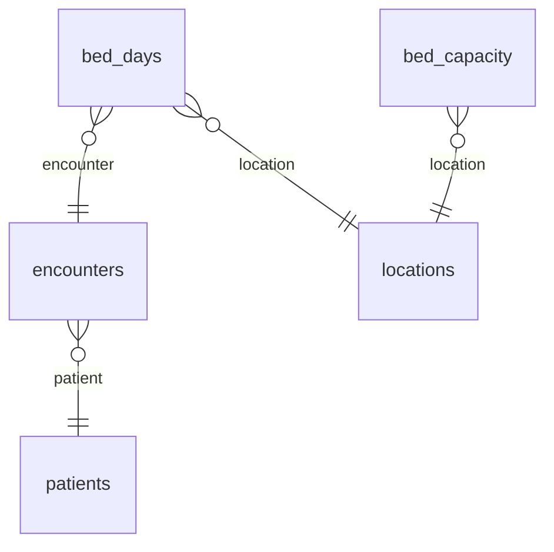

# Semantic layer (dbt MetricFlow)

The star schema answers any question, but every consumer that writes its own SQL can count admissions a little
differently. The semantic layer defines each business metric once, in `analytics/dbt/models/semantic/`, and dbt
MetricFlow turns a request such as "readmission rate by month and source" into the SQL. BI exports, the planned metrics
API and Airflow all ask for metrics by name and get the same numbers.

It is internal. MetricFlow returns raw counts, so nothing it returns leaves the warehouse directly: `analytics/metrics.py`
is the way out, and it applies small cell suppression first.

| Piece | Where |
|---|---|
| Semantic models, entities, dimensions, measures | `analytics/dbt/models/semantic/_semantic_models.yml` |
| Metrics (definition, owner, label, suppression rule) | `analytics/dbt/models/semantic/_metrics.yml` |
| Saved queries | `analytics/dbt/models/semantic/_saved_queries.yml` |
| Time spine | `dim_date` (`calendar_date`, day grain), configured in `models/marts/_marts.yml` |
| Bed capacity per day | `fact_bed_capacity_day` (new mart, the denominator of occupancy) |
| Suppressed queries | `analytics/metrics.py` |
| Parity with hand written SQL | `analytics/semantic_parity.py` |

Versions: `dbt-metricflow==0.15.0` (the `mf` command line), which brings `metricflow==0.213.0` and needs dbt Core 1.11
or 1.12; this repo pins `dbt-core==1.12.6` and `dbt-duckdb==1.11.0`.

## The model



| Semantic model | Table | Entities | Dimensions | Measures |
|---|---|---|---|---|
| `encounters` | `fact_encounter` | `encounter` (primary), `patient` (foreign) | `admit_date` (time, default), `discharge_date` (time), `source`, `class_code`, `encounter_kind`, `is_live_feed` | `encounters`, `admissions`, `ed_visits` (by admit day); `index_stays`, `readmissions_30d`, `length_of_stay_days_total` (by discharge day) |
| `patients` | `dim_patient` | `patient` (primary) | `sex`, `age_band`, `state`, `source_count` | none |
| `locations` | `dim_location` | `location` (primary) | `unit_name`, `unit_bed_capacity`, `location_level` | none |
| `bed_days` | `fact_bed_day` | `bed_day` (primary), `encounter`, `patient`, `location` (foreign) | `census_date` (time) | `bed_days` |
| `bed_capacity` | `fact_bed_capacity_day` | `bed_capacity_day` (primary), `location` (foreign) | `capacity_date` (time) | `capacity_bed_days` |

A dimension is asked for through its entity: `encounter__source`, `patient__age_band`, `location__unit_name`. Every
metric also has `metric_time`, at `day`, `week`, `month`, `quarter` or `year`. Admissions and emergency visits are
dated by the day the visit started; index stays, readmissions and length of stay by the day of discharge, like the
quality marts; bed days by the day whose midnight they count.

Bed days reach the encounter, so they can be split by `encounter__source` and filtered to the live feed. Capacity is
master data with no visit, so occupancy splits by unit and time only.

## Metrics catalog

| Metric | Definition | Type | Grain | Dimensions | Suppression |
|---|---|---|---|---|---|
| `admissions` | Hospital admissions that started in the period | simple | admit day | encounter, patient | count: 1 to 10 hidden |
| `ed_visits` | Emergency department visits that went home, by the day of arrival | simple | admit day | encounter, patient | count: 1 to 10 hidden |
| `average_length_of_stay_days` | Mean days from admission to discharge of hospital stays discharged in the period | ratio: `length_of_stay_days_total` / `index_stays` | discharge day | encounter, patient | mean: hidden when the stays are 1 to 10 |
| `readmission_rate_30d` | Share of hospital stays discharged in the period followed by another admission within 30 days (all cause, not risk adjusted) | ratio: `readmissions_30d` / `index_stays` | discharge day | encounter, patient | rate: hidden when the readmissions, the stays or the stays without a readmission are 1 to 10 |
| `bed_days` | Beds occupied at midnight, added up over the days of the period (Riverside General feed, demo) | simple | census day | encounter, patient, location | count: 1 to 10 hidden |
| `bed_occupancy_rate` | Occupied bed days out of available bed days in the period (demo) | ratio: `bed_days` / `capacity_bed_days` | census day | location | rate: hidden when the occupied, the available or the empty bed days are 1 to 10 |
| `admissions_rolling_28d` | Hospital admissions in the 28 days ending on each day of the period | cumulative, window 28 days | admit day | encounter, patient | count: 1 to 10 hidden |

Components, so the ratios can be built and checked: `index_stays`, `readmissions_30d`, `length_of_stay_days_total`
(each suppressed as a count, the total as a mean) and `capacity_bed_days` (beds, not people: not suppressed). Owners
are invented demo personas. The definitions match the quality marts (`int_quality_events`); see
`analytics/README.md` for how they differ from the official CMS and HEDIS versions.

A cumulative metric asked for by week or month gives the value on the first day of that week or month (MetricFlow's
default), that is the admissions of the 28 days ending then.

## Querying

Inside the warehouse, `mf` answers with raw numbers (run it from `analytics/dbt`, after `dbt parse` or a build):

```bash
cd analytics/dbt
export DBT_PROFILES_DIR=$PWD DBT_DUCKDB_PATH=$PWD/../../data/analytics/warehouse.duckdb
mf validate-configs
mf query --metrics admissions,ed_visits --group-by metric_time__week,encounter__source
mf query --metrics readmission_rate_30d --group-by metric_time__month,patient__age_band \
  --where "{{ Dimension('encounter__is_live_feed') }} = TRUE"
mf query --metrics bed_occupancy_rate --group-by metric_time__month,location__unit_name
mf query --saved-query quality_all_time --explain      # the SQL MetricFlow writes
```

Anything that leaves the warehouse goes through `metrics.py`, which sets the paths itself:

```bash
python3 analytics/metrics.py list                                            # the catalog
python3 analytics/metrics.py query --metrics admissions,readmission_rate_30d --group-by metric_time__month,encounter__source
python3 analytics/metrics.py query --saved-query ops_daily --csv ops_daily.csv
python3 analytics/metrics.py query --saved-query quality_all_time --json quality.json
python3 analytics/metrics.py validate                                        # dbt parse, then mf validate-configs
python3 analytics/semantic_parity.py                                         # every metric against hand written SQL
```

`query` adds the numerator and denominator each rule needs, asks MetricFlow, applies the rule, drops the components
nobody asked for, and returns one row per group with the metrics and `is_suppressed`. A hidden value is empty. When a
rate's numerator and denominator are both asked for, they are hidden together if their difference is 1 to 10.

On this repo's data (October 2026), `quality_all_time` shows readmissions of 0.2344 for the live feed (45 of 192 stays)
and 0.1927 for MIMIC (53 of 275), and hides Synthea's (4 of 76); average stays are 5.35, 6.88 and 6.80 days.

## Saved queries

| Saved query | Metrics | Grouped by | Filter |
|---|---|---|---|
| `ops_daily` | `admissions`, `ed_visits`, `bed_days` | `metric_time` by day, `encounter__source` | live feed only |
| `quality_all_time` | `readmission_rate_30d`, `average_length_of_stay_days` | `encounter__source` | none |

## How BI and the API use it

* **BI export** (`analytics/export_bi.py`, see the main README). It asks for `ops_daily` at day, week and month,
  `bed_occupancy_rate` by unit and month and `quality_all_time`, suppresses them with `metrics.suppress` and
  `metrics.complement`, then hides more where the tabs could be subtracted from each other (days, weeks and months;
  units against the month), and writes the rows to a Google Sheet that Tableau Public reads. `admissions_rolling_28d`
  is not exported: day to day differences of a rolling count give back the hidden daily counts. The dashboards build
  a four week sum from the weekly tab instead (`docs/tableau/DASHBOARD_SPEC.md`). The Airflow task `export_bi` runs
  it.
* **Metrics API** (`api/`, see `api/README.md`). A small FastAPI service calls `metrics.query()` with allowlisted
  metrics, dimensions, a time grain and filters on a slim serving snapshot of the warehouse, and returns the rows as
  JSON. It never exposes `mf` or `raw_query()`. It also turns on `complementary=True`: along each group by column,
  while the hidden cells add up to 1 to 10, the smallest shown cell is hidden too (`metrics.complement`), so a total
  from another query cannot give a hidden cell back. The command line default is unchanged.
* **Airflow.** `validate_semantic_layer` runs `metrics.py validate` after `dbt_build_and_test`, so a model change that
  breaks a metric (a renamed column, a dimension that no longer joins) fails the night before anyone queries it.

## Checks

* `mf validate-configs` (through `metrics.py validate`): semantic checks, then each semantic model, dimension, entity,
  measure and metric queried against the warehouse.
* `semantic_parity.py`: each metric against SQL written by hand on the marts, all time by source, monthly for the live
  feed, occupancy by unit, the rolling count per day. Counts must be equal, ratios and sums within 1e-9. On this repo's
  data: 0 differences. `tests/test_semantic.py` runs it on a small warehouse every time and on
  `data/analytics/warehouse.duckdb` when that exists and has been rebuilt with the semantic layer.
* `tests/test_semantic.py`: the catalog (label, owner, one line definition and a rule for every metric), the
  suppression rule on every combination of small and large counts, and every metric by day, week and month with two
  dimensions on a small warehouse.
* dbt tests on `fact_bed_capacity_day`: keys, relationships, one row per bed per day, and no occupied bed outside it
  (so occupancy never passes 100 percent).

## Limits

* Suppression covers each returned cell and the complement of a rate shown with its parts. It does not do the
  complementary suppression of `mart_quality_period` across rows: a reader who runs two queries (for example by
  source and in total) could subtract. The metrics API turns on complementary suppression, and the BI export adds
  checks across its tabs for that reason.
* `mf validate-configs` prints one warning: dbt's semantic YAML gives a cumulative metric a measure, and MetricFlow
  0.213 converts it and notes that the measure is ignored. The numbers are checked by the parity script.
* Capacity is the beds known now; the reference data keeps no history of beds.
* Dates are the demo's: MIMIC periods are shifted into the 2100s and only the live feed has real dates.
